[portfolio](https://mayank-gandhi.vercel.app/) &nbsp;·&nbsp;
[linkedin](https://www.linkedin.com/in/mayankgandhi0713/) &nbsp;·&nbsp;
[orcid](https://orcid.org/0009-0000-3448-9308) &nbsp;·&nbsp;
[email](mailto:135.mayankgandhi@gmail.com) &nbsp;·&nbsp;
[northeastern](mailto:gandhi.may@northeastern.edu)

> MS Bioinformatics at Northeastern, in Boston. B.Tech Biotechnology, MIT-ADT University. 
> I like problems where the biology is messy and the model has to earn its keep.

Bioinformatics, genomics and AI for biological data. Mostly single-cell and bulk 
transcriptomics: RNA-seq pipelines (STAR, Salmon, DESeq2) on HPC, deconvolution, and 
rewriting slow R tools in Rust so they fit in memory. Also machine learning for 
biomarker discovery and antimicrobial resistance.

Before Boston I was at [NCBS](https://www.ncbs.res.in/) in Bangalore, building signalling models of synapses 
for neurodegenerative disease: ODEs and HillTau, checked against experiments with FindSim. 
Most recently, software developer intern at Cencora on EDI/X12 healthcare integrations.

<samp>python &nbsp; R &nbsp; rust &nbsp; bash &nbsp; bioconductor &nbsp; numpy &nbsp; pandas &nbsp; pytorch &nbsp; seaborn &nbsp; hilltau</samp> 
<samp>javascript &nbsp; react &nbsp; angular &nbsp; mysql &nbsp; mongodb &nbsp; oracle &nbsp; docker &nbsp; tableau &nbsp; git &nbsp; linux</samp>

**[doublet-rs](https://github.com/mayankgandhi13/doublet-rs)** &nbsp;·&nbsp; <samp>rust, R, python</samp> 
Memory-efficient Rust reimplementation of DoubletFinder for scRNA-seq doublet 
detection, with R (extendr) and Python (PyO3) bindings.

**[gliph2-rs](https://github.com/mayankgandhi13/gliph2-rs)** &nbsp;·&nbsp; <samp>rust, R, python</samp> 
Fast, deterministic Rust reimplementation of GLIPH2: clusters T-cell receptors 
by antigen specificity. Same bindings, same idea.

**[cellchatr](https://github.com/mayankgandhi13/cellchatr)** &nbsp;·&nbsp; <samp>R, rust</samp> 
R package for querying the CellChat database, backed by Rust via extendr.

**[Multi-Omics-AMR-Prediction](https://github.com/mayankgandhi13/Multi-Omics-AMR-Prediction-with-Attention-Fusion)** &nbsp;·&nbsp; <samp>python, pytorch</samp> 
Predicts E. coli antimicrobial resistance by fusing WGS, pangenome and 
transcriptomics in an attention model, with SHAP to show what it learned.

**[scqc](https://github.com/mayankgandhi13/scqc)** &nbsp;·&nbsp; <samp>rust</samp> 
Single-cell RNA-seq QC pipeline, written in Rust.

Every graphic here is generated, not embedded from anyone else's server. 
`ascii.svg` is a photo pushed through a character ramp by 
[`scripts/make_portrait.py`](scripts/make_portrait.py); the stat graphics and 
these section headings are drawn by [a scheduled action](.github/workflows/stats.yml) 
straight from the GitHub GraphQL API, once a day, committing only what changed.

They animate with SMIL inside the SVG, because GitHub strips scripts from 
READMEs — and since nothing loads from a third party, nothing here can 
rate-limit or go dark. The headings are SVGs for the same reason: GitHub also 
strips CSS, so an image is the only way to put this page's own typeface on them.

The typeface is [JetBrains Mono](scripts/fonts), subset to just the characters 
each graphic draws and inlined as base64. That isn't only for looks: the 
portrait's grid assumes an advance width of exactly 0.600 em, and a viewer whose 
default monospace is narrower would otherwise see it squeezed.

Language totals cover public repositories only. `year.svg` uses the portrait's 
character ramp: `:` `+` `#` `@`, quiet to loud.
